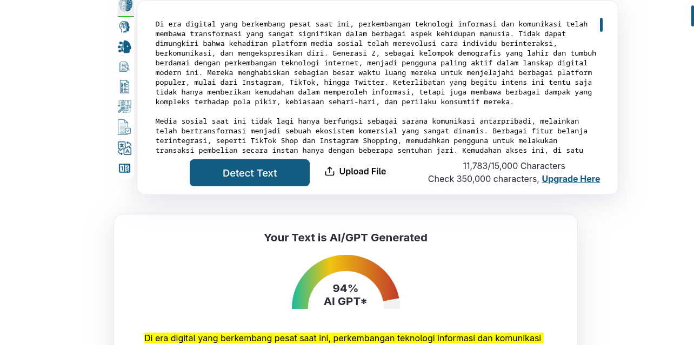
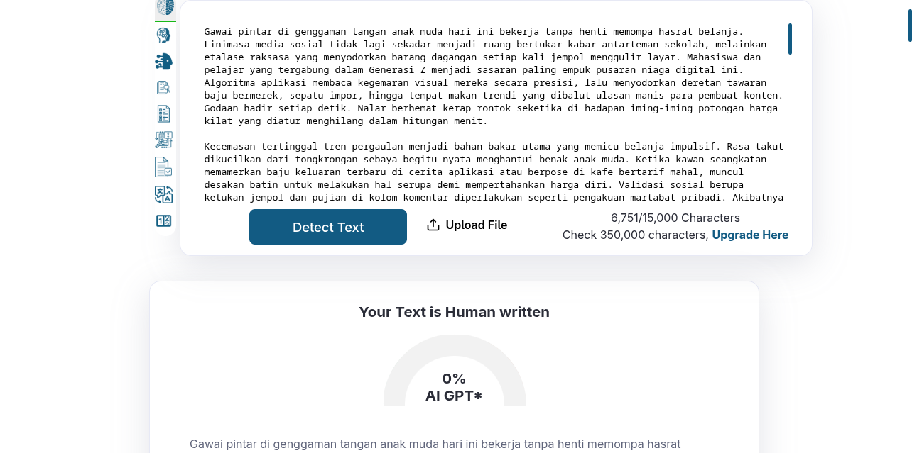
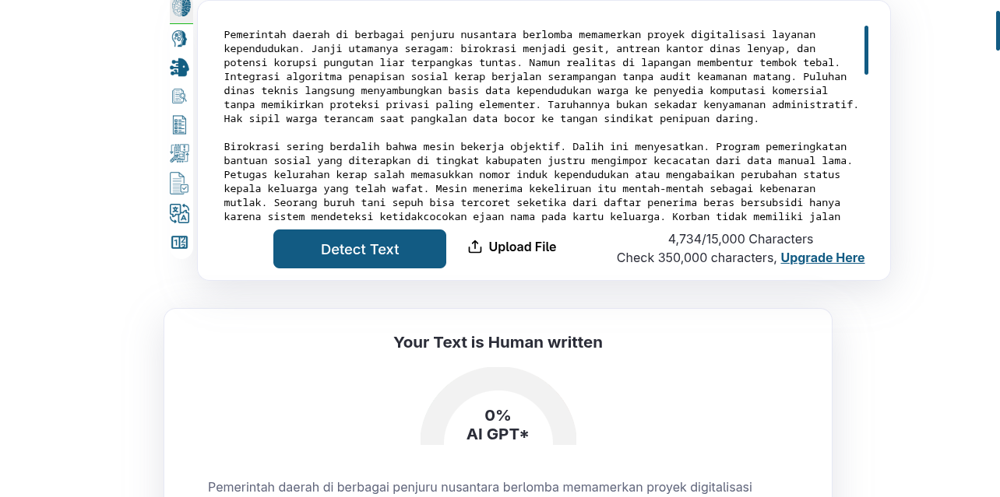
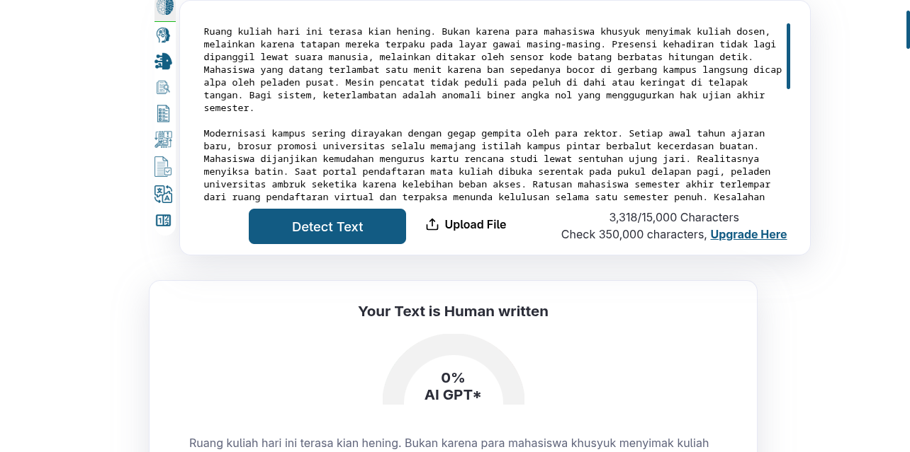

# Benchmark & Evaluasi: Skill `manusiakan`

Repositori pengujian dan bukti benchmark empiris untuk skill **`manusiakan`** (Antigravity). Menghapus pola sintetis AI, kalk terjemahan (*translationese*), dan struktur monoton dari draf bahasa Indonesia ragam formal dan semi-formal.

---

## 1. Hasil Uji Terkontrol (A/B Test)

Pengujian dilakukan menggunakan detektor **ZeroGPT** dengan topik: *"Dampak Media Sosial terhadap Gaya Hidup dan Pola Konsumtif Generasi Z di Indonesia"*.

| Kondisi | Berkas Sampel | Panjang | Skor ZeroGPT | Status Visual |
| :--- | :--- | :--- | :--- | :--- |
| **BEFORE** *(Raw AI Murni)* | [`samples/raw_ai_mentah.md`](samples/raw_ai_mentah.md) | 11.783 karakter | **94% AI** | 58 kalimat terblok kuning (*AI GPT*) |
| **AFTER** *(Skill Manusiakan)* | [`samples/humanized_hasil.md`](samples/humanized_hasil.md) | 6.751 karakter | **0% AI** | 0 kalimat terdeteksi (*Human Written*) |

> **Delta Penurunan**: **94% → 0% AI** pada topik materi yang sama.

---

## 2. Bukti Visual Deteksi (Tangkapan Layar)

### Sebelum: 94% Terdeteksi AI (Raw AI ChatGPT)


### Sesudah: 0% Terdeteksi AI (Dipoles Skill `manusiakan`)


---

## 3. Sampel Ragam Tambahan

| Ragam Bahasa | Berkas Sampel | Topik Bahasan | Skor ZeroGPT | Bukti Gambar |
| :--- | :--- | :--- | :--- | :--- |
| **Formal (Makalah)** | [`samples/formal_makalah.md`](samples/formal_makalah.md) | Tata Kelola Algoritma & Privasi Data Warga | **0% AI** |  |
| **Semi-Formal (Esai)** | [`samples/semiformal_esai.md`](samples/semiformal_esai.md) | Modernisasi Kampus & Friksi Sosial | **0% AI** |  |

---

## 4. Struktur Folder

```text
benchtest/
├── README.md               # Laporan ringkas & display visual benchmark
├── samples/                # Berkas draf teks pengujian (Markdown)
│   ├── raw_ai_mentah.md    # Draf mentah sebelum dipoles (94% AI)
│   ├── humanized_hasil.md  # Hasil polesan bernas (0% AI)
│   ├── formal_makalah.md   # Draf ragam makalah formal (0% AI)
│   └── semiformal_esai.md  # Draf ragam esai semi-formal (0% AI)
└── images/                 # Bukti tangkapan layar utama
    ├── zerogpt_raw_before.png
    ├── zerogpt_humanized_after.png
    ├── zerogpt_formal.png
    └── zerogpt_semiformal.png
```
